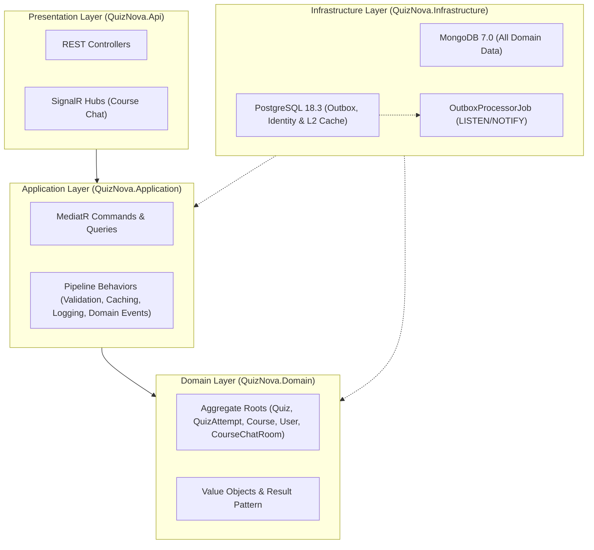
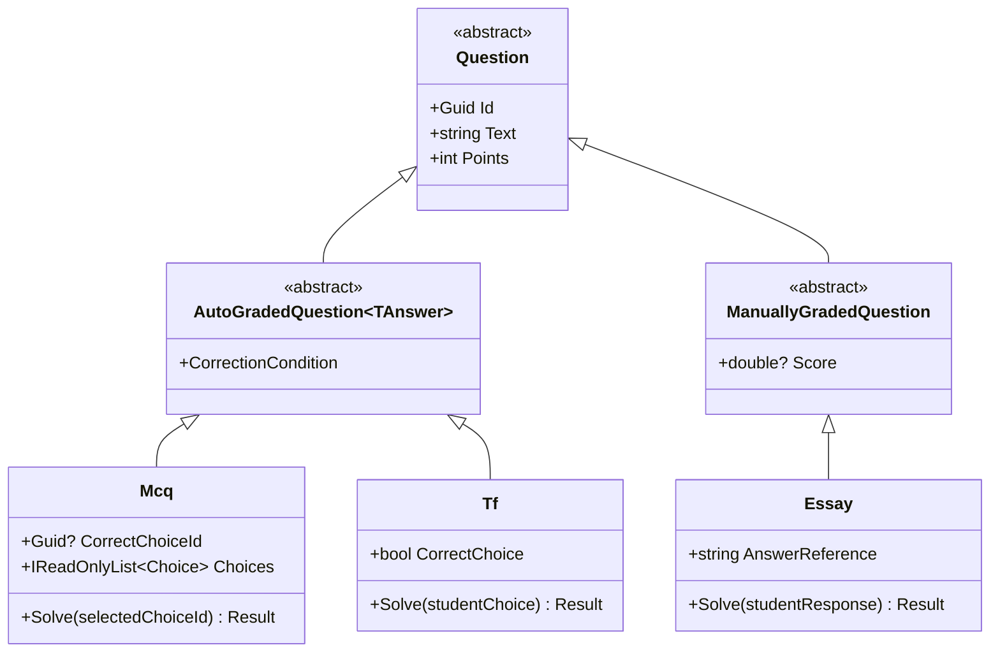

# QuizNova API

**Live Application:** [quiznova.dev](https://quiznova.dev) _(Fallback mirror:
[GitHub Pages](https://moamenelbarqy.github.io/quiz-nova/))_

Backend REST and SignalR API for the **QuizNova** assessment platform, built by
[Moamen Elbarky](https://github.com/moamenelbarky) to explore Clean
Architecture, Domain-Driven Design (DDD), document data modeling, and cloud
automation.

[](https://dotnet.microsoft.com/)
[](https://www.mongodb.com/)
[](https://www.postgresql.org/)
[](https://github.com/quiz-nova/quiznova-api/actions)

> [!NOTE] **Live Demo & Cold-Start Notice:** This project is deployed for
> demonstration and learning purposes. The backend API runs on Azure Container
> Apps with **scale-to-zero** enabled, so the first request after inactivity may
> take **10–15 seconds** while the container cold-starts. Additionally, the live
> demo may occasionally be unavailable if monthly free-tier cloud credits or
> quotas are exhausted.

---

## Table of Contents

- [Related Repositories & Wiki](#related-repositories--wiki)
- [Architecture Overview](#architecture-overview)
- [Key Features & Design Highlights](#key-features--design-highlights)
- [Tech Stack](#tech-stack)
- [Testing Strategy](#testing-strategy)
- [Getting Started](#getting-started)
- [Infrastructure & CI/CD](#infrastructure--cicd)
- [Author](#author)

---

## Related Repositories & Wiki

QuizNova is split across four repositories in the
[`quiz-nova`](https://github.com/quiz-nova) organization:

- **[`quiznova-api`](https://github.com/quiz-nova/quiznova-api)** _(Current)_:
  .NET 10 backend API, domain logic, and service-level Terraform configurations.
- **[`quiznova-web`](https://github.com/quiz-nova/quiznova-web)**: Angular 21
  frontend Single Page Application (SPA).
- **[`quiznova-infra`](https://github.com/quiz-nova/quiznova-infra)**: Platform
  Terraform configuration managing organization repositories, Azure state
  storage, and Datadog monitors.
- **[`quiznova-api.wiki`](https://github.com/quiz-nova/quiznova-api/wiki)**:
  Engineering notes, database schemas, and architecture discussions:
  - [From Relational Modeling to Document Modeling](https://github.com/quiz-nova/quiznova-api/wiki/From-Relational-Modeling-to-Document-Modeling)
  - [Learning Domain-Driven Design (DDD)](https://github.com/quiz-nova/quiznova-api/wiki/DDD)
  - [Stop Treating Objects as Dump Lines](https://github.com/quiz-nova/quiznova-api/wiki/Stop-treat-the-object-as-dump-lines)
  - [Eventual Consistency & Denormalization](https://github.com/quiz-nova/quiznova-api/wiki/Eventual-Consistency)
  - [Infrastructure as Code (IaC) Journey](https://github.com/quiz-nova/quiznova-api/wiki/IaC)
  - [Managing Secrets with Doppler](https://github.com/quiz-nova/quiznova-api/wiki/Doppler)

---

## Architecture Overview

QuizNova follows **Clean Architecture** principles, enforcing an inward
dependency flow so the domain model stays isolated from database and framework
concerns.



- **CQRS via MediatR**: Requests pass through pipeline behaviors for
  `FluentValidation`, caching, logging, and domain event publishing.
- **Result Pattern**: Uses an explicit `Result<T>` type and strongly typed
  `Error` objects instead of throwing exceptions for expected business failures.
- **Rich Domain Models**: Entities enforce invariants through behavior methods
  like `question.Solve(...)` and `course.Enroll(student)` rather than acting as
  anemic data bags (see
  [Wiki discussion](https://github.com/quiz-nova/quiznova-api/wiki/Stop-treat-the-object-as-dump-lines)).

---

## Key Features & Design Highlights

### Polymorphic Question Hierarchy

Questions and answers are modeled using a polymorphic hierarchy mapped to
MongoDB documents via `BsonClassMap` discriminators (`mcq`, `tf`, `essay`):



### Core Capabilities

- **Role-Based Access Control (RBAC)**: Distinct permissions for **Admins**
  (courses and enrollments), **Instructors** (quiz creation and essay grading),
  and **Students** (quiz attempts and course chat).
- **Gradual Quiz Attempt Flow**: Supports starting an attempt, submitting
  individual answers (`MCQ`, `True/False`, `Essay`), and completing within a
  timed window.
- **Real-Time Course Chat**: Powered by **SignalR** for instant messaging and
  emoji reactions inside courses.
- **Hybrid Caching**: Combines L1 in-memory cache with L2 PostgreSQL distributed
  cache via `ICachedQuery` pipeline behaviors and inline cache invalidation.

---

## Tech Stack

| Layer                   | Technologies                                                 |
| :---------------------- | :----------------------------------------------------------- |
| **Backend**             | .NET 10, ASP.NET Core, MediatR, FluentValidation, SignalR    |
| **Primary Database**    | MongoDB 7.0 / MongoDB Atlas (`MongoDB.Driver`)               |
| **Outbox & Auth Store** | PostgreSQL 18.3, EF Core, ASP.NET Core Identity, HybridCache |
| **Observability**       | Datadog                                                      |
| **Cloud & Secrets**     | Azure Container Apps, Azure Key Vault, Terraform, Doppler    |

---

## Testing Strategy

The repository organizes automated tests across four projects under `tests/`:

- **`QuizNova.Domain.UnitTests`**: Tests domain invariants, question grading
  rules, and attempt transitions.
- **`QuizNova.Application.UnitTests`**: Tests MediatR pipeline behaviors,
  mappers, and validators.
- **`QuizNova.Application.SubcutaneousTests`**: Tests application command/query
  handlers against real database instances.
- **`QuizNova.Api.IntegrationTests`**: Verifies HTTP endpoints using
  **Testcontainers** for PostgreSQL and MongoDB.

---

## Getting Started

### 1. Start Local Databases

```bash
git clone https://github.com/quiz-nova/quiznova-api.git
cd quiznova-api
cp .env.example .env
docker compose up -d db mongodb
```

### 2. Run the API

```bash
dotnet run --project src/QuizNova.Api
```

Once running, the API is available at `http://localhost:8080` (with Swagger UI
at `/swagger` and Scalar API reference at `/scalar`).

### Demo Credentials

The database seeds three demo accounts on startup:

| Role           | Email                         | Password         |
| :------------- | :---------------------------- | :--------------- |
| **Admin**      | `admin@quiznova.local`        | `Admin123!`      |
| **Instructor** | `ahmed.nasser@quiznova.local` | `Instructor123!` |
| **Student**    | `omar.yasser@quiznova.local`  | `Student123!`    |

---

## Infrastructure & CI/CD

### Terraform & Secrets

Service-level infrastructure lives under `terraform/`:

- **Environments**: `terraform/environments/{dev,stg,prd}` calling the reusable
  `terraform/modules/api_environment` module.
- **Resources**: Provisions Azure Container Apps (configured with
  scale-to-zero), Azure Key Vault secrets, and OIDC federated credentials.
- **Secrets**: Managed centrally in **Doppler** and injected into Azure Key
  Vault rather than storing plaintext `.tfvars` files (see
  [IaC Wiki](https://github.com/quiz-nova/quiznova-api/wiki/IaC) and
  [Doppler Wiki](https://github.com/quiz-nova/quiznova-api/wiki/Doppler)).

### GitHub Actions Workflows

- **`build-and-test.yml`**: Runs `dotnet format`, builds with warnings as
  errors, executes unit/integration tests, and uploads coverage on every PR.
- **`publish-backend-to-ghcr.yml`**: Builds the Docker image, pushes it to
  GitHub Container Registry (GHCR), and deploys revisions to Azure Container
  Apps via passwordless OIDC.

---

## Author

Developed by **[Moamen Elbarky](https://github.com/moamenelbarky)**.
